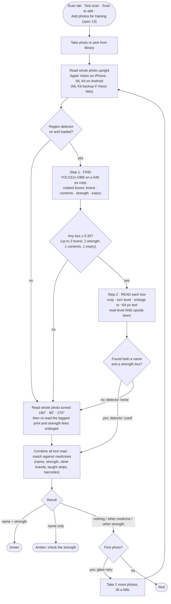
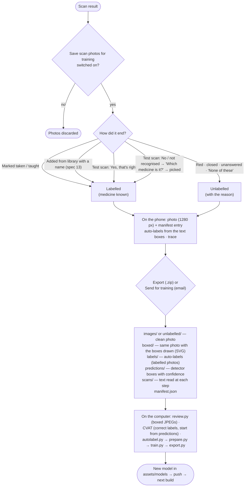

# Spec 12 — Strip scan pipeline (how a scan works, end to end)

How a strip photo becomes green / amber / red, and what is kept for retraining. Ties together spec 05 (expiry),
spec 10 (region detector and text readers) and spec 11 (test scan). Diagrams are Mermaid; GitHub draws them.

## 1. The scan, step by step

Scan to add takes three photos at once (tilting between them) instead of the one-then-two glare retry.

Every reading in this flow is one **step** recorded in the photo's **trace** (section 3).

Why "both a name and a strength box": the trial model finds brands about half the time and strengths rarely. Skipping
the slow every-way-up reading on a brand box alone would miss strengths, so the detector only replaces it when it found
both; otherwise its crops are extra readings on top. A weak detector can't make a scan worse.

## 2. What happens to the photos

## 3. The trace: both steps, kept with every photo

A scan has two steps that can fail separately — **finding** the printed areas (the detector) and **reading** them
(the text reader). A failed scan is only useful for improving the right step if it says which one failed. So for every
photo read, `src/ocr.ts` keeps a trace (`src/scanTrace.ts`), saved in the photo's manifest entry and exported:

| Kept | Where in the export | Answers |
|---|---|---|
| Clean photo | `images/` (labelled) or `unlabelled/` | — |
| Photo with the boxes drawn on it, and the text of every step beside it | `boxed/<photo>.svg` (opens in a browser; solid = cropped and read, dashed = found but not read) | Where did it look? |
| Detector boxes: class, confidence, rotated corners (0…1), picked or not | `predictions/<photo>.txt` (YOLO-OBB + confidence) and `trace.regions` | Did step 1 find the name and strength? |
| Every reading: what was read (upright, each turn, each crop, each re-read), by which reader, how long | `scans/<photo>.txt` and `trace.steps` | Did step 2 read them correctly? |
| What the detector did: off · missing · nothing · extra · used | first line of `scans/<photo>.txt`, `trace.detector` | Was the fast path taken? |

How to read a failed scan (`training/review.py --only-failed` makes JPEGs of the boxed photos):
* **No box on the name or strength** → step 1 failed: correct the boxes in CVAT (load `predictions/` as a start) and
  retrain the detector.
* **Box in the right place, wrong or no text** → step 2 failed: glare, blur or print too small for the reader.
  More enlargement, or a better reader, helps — not more detector training.
* **Right text, still no match** → the medicine's saved name or strength, or the matching rules (`src/match.ts`).

Size: about 1–3 KB of text per photo next to a ~200 KB photo. Traces are kept in memory for the last 40 photos only
(a photo can only be saved shortly after it was read).

## 4. Code map

| Part | File |
|---|---|
| Scan screens | `app/(tabs)/scan.tsx`, `app/test-scan.tsx`, `app/scan-add.tsx` |
| Reading flow, detector path, glare retry, traces | `src/ocr.ts` |
| Text readers | `modules/apple-text/` (iPhone), `@react-native-ml-kit/text-recognition` |
| Detector run / decode | `src/regionModel.ts` / `src/obb.ts` |
| Trace, predictions file, boxed SVG, readable account | `src/scanTrace.ts` |
| Matching | `src/match.ts`, `src/learn.ts` (taught strips), `src/label.ts` |
| Training photos, export, email | `src/training.ts` |
| Computer side | `training/` (README there) |

## Tests
`tests/scanTrace.test.ts`: boxes kept relative and written as predictions with confidence (clamped to the photo);
steps capped; readable account per step; "no boxes" said plainly; boxed SVG points at the exported photo by relative
path, picked boxes solid and others dashed, text escaped. `tests/obb.test.ts` and `tests/testScan.test.ts` cover the
detector decoding and test-scan outcomes.

## Strength and QR safety (24 Oct 2026)
* A strength printed with its unit, or right after the name, that disagrees with the prescription wins over the
  expected number turning up elsewhere on the strip (`strengthClash` in `src/match.ts`; same rule in
  `src/household.ts`). Temperatures, addresses and pack counts are removed first. Combination strengths that add up
  agree (500 + 125 = 625).
* QR text goes through the same look-alike and strength checks as printed text. Only a linked barcode goes straight
  to green.
* A taught strip gives green only when the strength is read too (amber otherwise), and is compared against every
  taught strip in the house.
* A result is dropped if the person on screen changed during the read; the person picker is hidden while reading.
* Tests: `tests/strength-safety.test.ts`.
